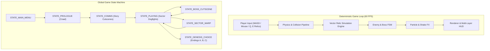
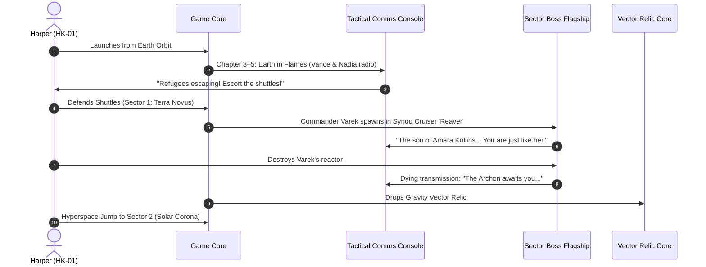

# SPACE JAM: THE LAST VECTOR
## Master C Systems Engineering & Technical Architecture Specification

**Author:** Harper Kollins (Creator) & Lead Game Design / C Systems Engineer  
**Target Engine:** C11 / Raylib 6.2 / MinGW UCRT64  
**Binary:** `spacejam.exe`  

---

### 1. Executive Systems Architecture

To evolve *SPACE JAM* from an arcade wave shooter into a cinematic space opera Action-RPG, the C architecture must remain cache-friendly, zero-heap-allocation during the gameplay loop, and deterministic.

---

### 2. The Seven Vectors Engine Specification (`relic.h` / `relic.c`)

Each Vector relic is represented as an in-game active/passive ability with its own energy gauge, cooldown timer, and screen-space distortion shader/particle effect:

| Vector Relic | Key | Gameplay Effect | Visual & Audio Signature |
| :--- | :---: | :--- | :--- |
| **1. Genesis Vector** | Passive | Overcharges plasma cannons with Architect resonance (+40% dmg, piercing). | Radiant cyan muzzle flash, harmonic resonance hum. |
| **2. Gravity Vector** | `Q` | Spatially collapses target zone. Pulls all enemies & asteroids into a crushing singularity for 3.0s. | Inverted purple event horizon, deep sub-bass vacuum implosion. |
| **3. Temporal Vector** | `E` | Temporal Phase-Slip: Rewinds player position & shields 2.5s into past; decelerates all hostiles to 25% speed for 4.0s. | Emerald chrono-trails, chronometer tick audio, reverse-particle suction. |
| **4. Quantum Vector** | `L-SHIFT` | Instant micro-warp blink in flight trajectory (250px), leaving kinetic shockwave that deflects bullets. | Bright electric blue strobe, lightning arc discharge. |
| **5. Void Vector** | `F` | Phasic dematerialization for 3.5s (invulnerable to hull collision, passes through asteroids and lasers). | Translucent spectral ship silhouette, high-pitch ethereal ring. |
| **6. Nexus Vector** | Passive | Smart-links weapon targeting, chaining arc lightning between nearby Synod fighters. | Crackling branching cyan arcs jumping between targets. |
| **7. Ascendant Vector**| Story | Unlocks Secret Ending C inside the Genesis Engine core at the Citadel. | Pure blinding white-gold cosmic radiance. |

---

### 3. The Multi-Act Narrative & Boss Encounter FSM

Gameplay chapters strictly mirror *Episode I*:

---

### 4. Zero-Heap Allocation Memory Contract

All gameplay objects live in pre-allocated static pools:
* `MAX_PLAYER_BULLETS = 128`
* `MAX_ENEMY_BULLETS = 256`
* `MAX_ENEMIES = 48`
* `MAX_ASTEROIDS = 32`
* `MAX_PARTICLES = 1024`
* `MAX_RELIC_EFFECTS = 16`
* `MAX_CUTSCENE_LINES = 16`

Total memory footprint: **< 18 MB RAM**, ensuring instantaneous load times, 60 FPS lock on any hardware, and zero garbage collection pauses.
